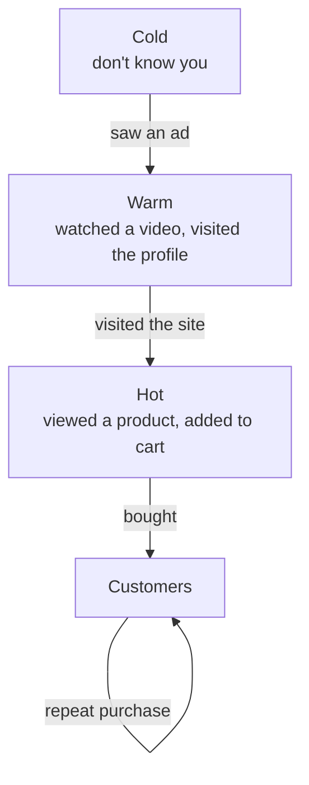

# Warm audiences and the funnel

Not everyone is equally ready to buy. Some see you for the first time, some have visited your site three times. The funnel is a simple way to think about this.

## What changed in 2026
Each stage used to get its own campaign. Now the Advantage+ autopilot shows ads to both new and warm people, so **separate retargeting is needed less often**. (practice)

But you still need your own audiences:

- **for exclusions** — don't show a "first time here?" ad to people who already bought;
- **as a suggestion** for the robot;
- **for a separate offer** — when you have something special to tell warm people;
- **for reports** — audience segments show how much money goes to people who know you ([Non-obvious things](08-hidden.md)).

## Which custom audiences you can build
"Audiences" in Ads Manager → "Create audience" → "Custom audience".

| Source | Who's in it | How long it's kept |
|---|---|---|
| Website (pixel) | Site visitors, specific pages, people who added to cart | up to 180 days; purchasers up to 730 days |
| Instagram account | Visited the profile, interacted, sent a DM | up to 365 days |
| Facebook Page | Interacted with the Page | up to 365 days |
| Video | Watched 25%, 50%, 75%, 95% of a video | up to 365 days |
| Instant forms | Opened or submitted a form | up to 90 days |
| Customer list | An uploaded file with emails and phone numbers | until you delete it |

Upload customer lists only in line with GDPR: there must be a lawful basis for that data processing.

## Ready-made sets
Give them clear names, e.g. "SITE-cart-14d" or "IG-engaged-90d".

- **Cart without purchase, 7–14 days** — the hottest.
- **Viewed a product, 30 days**.
- **Watched 50%+ of a video, 90 days** — warm.
- **Engaged with Instagram, 180 days**.
- **Purchasers, 180 days** — to exclude or for repeat sales.

## When a separate campaign for warm people makes sense
- You have a **special offer**: "come back — free delivery", "you looked at the set — here are its reviews".
- A **long decision cycle**: an expensive service, an event. You need reminders, answers to objections, reviews.
- **Repeat sales**: consumables, seasonal goods. To buyers after 2–3 months — "time for a refill".

Warm audiences are small. Keep their budget small; frequency rises fast. Make sure ads don't become stalking: above 3–4 impressions per person a week, people start getting annoyed. (practice)

## What to show at each stage
| Stage | What the person needs | Anya's example |
|---|---|---|
| Cold | A hook, show the value | "This candle burns for 60 hours" |
| Warm | Trust, details | The making process, reviews |
| Hot | Remove last doubts | Delivery, returns, "5 sets left" (if true) |
| Customers | A reason to come back | New scents, a holiday set |

## Sources
- [Meta for Developers: website custom audiences](https://developers.facebook.com/documentation/ads-commerce/marketing-api/audiences/guides/website-custom-audiences)
- [Common Thread: purchaser audience retention of 730 days](https://commonthreadco.com/blogs/coachs-corner/meta-purchase-audience-730-days-ecommerce)
- [Benly: custom audience types and retention](https://benly.ai/learn/meta-ads/custom-audiences-guide)
- [Shopify: retargeting and custom audiences](https://shopify.co.nz/guides/facebook-advertising/retargeting-and-custom-audiences)

Checked: November 2026.

--8<-- "abbr-en.md"
