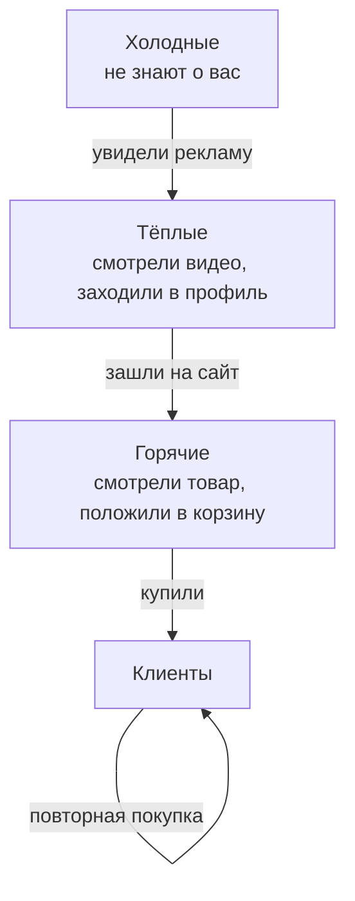

# Тёплая аудитория и воронка

Не все люди одинаково готовы купить. Кто-то видит вас впервые, кто-то уже был на сайте трижды. Воронка — простой способ думать об этом.

## Что изменилось в 2026
Раньше для каждого этапа делали отдельную кампанию. Сейчас автопилот Advantage+ сам показывает рекламу и новым, и тёплым людям, поэтому **отдельный ретаргетинг нужен реже**. (практика)

Но свои аудитории всё равно нужны:

- **для исключений** — не показывать рекламу «приходите впервые» тем, кто уже купил;
- **как подсказка** роботу;
- **для отдельного оффера** — когда тёплым есть что сказать особого;
- **для отчётов** — в сегментах аудитории видно, сколько денег уходит своим ([Неочевидные вещи](08-hidden.md)).

## Какие свои аудитории можно собрать
Раздел «Аудитории» в Ads Manager → «Создать аудиторию» → «Индивидуально настроенная аудитория».

| Источник | Кто туда попадает | Сколько хранится |
|---|---|---|
| Сайт (пиксель) | Посетители сайта, отдельных страниц, те, кто положил в корзину | до 180 дней; покупатели — до 730 дней |
| Instagram-аккаунт | Заходили в профиль, взаимодействовали, писали в Direct | до 365 дней |
| Страница Facebook | Взаимодействовали со страницей | до 365 дней |
| Видео | Досмотрели видео до 25%, 50%, 75%, 95% | до 365 дней |
| Мгновенные формы | Открыли или отправили форму | до 90 дней |
| Список клиентов | Загруженный файл с email и телефонами | пока не удалите |

Списки клиентов загружайте только с соблюдением GDPR: у людей должна быть законная основа на такую обработку данных.

## Готовые наборы
Названия делайте понятными, например «САЙТ-корзина-14д» или «IG-взаимодействие-90д».

- **Корзина без покупки, 7–14 дней** — самые горячие.
- **Смотрели товар, 30 дней**.
- **Досмотрели видео на 50%+, 90 дней** — тёплые.
- **Взаимодействовали с Instagram, 180 дней**.
- **Покупатели, 180 дней** — для исключения или для повторных продаж.

## Когда отдельная кампания для тёплых имеет смысл
- Есть **особый оффер**: «вернитесь — бесплатная доставка», «вы смотрели набор — вот отзывы о нём».
- **Длинный цикл решения**: дорогая услуга, мероприятие. Нужны напоминания, ответы на возражения, отзывы.
- **Повторные продажи**: расходники, сезонные товары. Покупателям через 2–3 месяца — «пора обновить».

Тёплая аудитория маленькая. Бюджет на неё — небольшой, частота быстро растёт. Следите, чтобы реклама не превратилась в навязчивое преследование: при частоте выше 3–4 в неделю люди начинают раздражаться. (практика)

## Что показывать на каждом этапе
| Этап | Что нужно человеку | Пример для Ани |
|---|---|---|
| Холодные | Зацепить, показать ценность | «Эта свеча горит 60 часов» |
| Тёплые | Доверие, детали | Процесс изготовления, отзывы |
| Горячие | Снять последние сомнения | Доставка, возврат, «осталось 5 наборов» (если правда) |
| Клиенты | Повод вернуться | Новые ароматы, набор к празднику |

## Источники
- [Meta for Developers: аудитории посетителей сайта](https://developers.facebook.com/documentation/ads-commerce/marketing-api/audiences/guides/website-custom-audiences)
- [Common Thread: срок хранения аудитории покупателей — 730 дней](https://commonthreadco.com/blogs/coachs-corner/meta-purchase-audience-730-days-ecommerce)
- [Benly: виды индивидуальных аудиторий и сроки хранения](https://benly.ai/learn/meta-ads/custom-audiences-guide)
- [Shopify: ретаргетинг и индивидуальные аудитории](https://shopify.co.nz/guides/facebook-advertising/retargeting-and-custom-audiences)

Проверено: ноябрь 2026.

--8<-- "abbr-ru.md"
