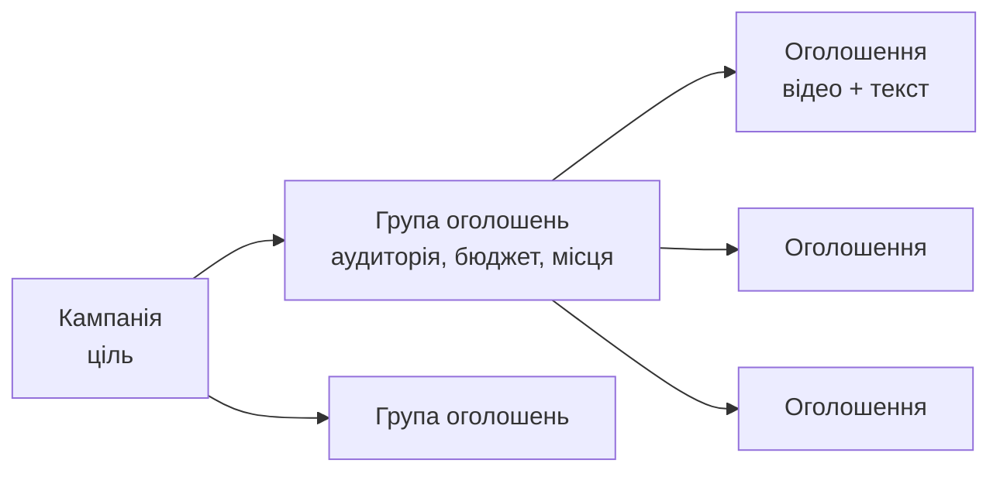
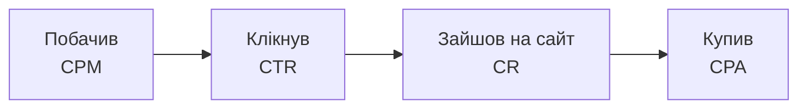

# Основи та цифри

## Як влаштована реклама: три поверхи
Будь-яка реклама в Meta схожа на матрьошку з трьох шарів:

- **Кампанія**: навіщо ми все це затіяли. Наприклад, «хочу продажі».
- **Група оголошень**: кому показуємо, де і скільки витрачаємо.
- **Оголошення**: те, що бачить людина. Картинка або відео плюс текст.

!!! example "Приклад Ані"
    Кампанія «Продажі свічок до Нового року» → група «Угорщина, 22–55 років, 20 € на день» → три оголошення: відео, як запалюється свічка; фото подарункової коробки; відгук покупчині.

## Словничок: 10 слів, без яких нікуди
**Оптимізація**
: що ви просите робота знайти. Кліки? Заявки? Покупки? Він шукатиме саме це.

**Навчання**
: перші дні після запуску, коли робот придивляється, кому показувати. Йому потрібно приблизно 50 потрібних дій за тиждень. Поки він вчиться, результати стрибають — це нормально.

**Холодні, теплі, гарячі**
: холодні про вас не чули, теплі вже заходили в профіль чи на сайт, гарячі майже купили.

**Ретаргетинг**
: реклама навздогін тим, хто вже заходив. Той самий випадок, коли кросівки «переслідують» вас по всьому інтернету.

**Схожа аудиторія (lookalike)**
: «знайди мені людей, схожих на моїх покупців». Зараз робот і так цим займається, тож окремо вона потрібна рідко.

**Плейсмент**
: де показується реклама: у стрічці, в Reels, у сторіз, у Threads.

**Частота**
: скільки разів одна людина в середньому бачила вашу рекламу.

**Вигорання**
: коли люди надивилися на ту саму рекламу й перестали реагувати. Як пісня, яку крутять по радіо вдесяте за день.

**Креатив**
: картинка або відео в оголошенні.

**Офер**
: сама пропозиція. «Свічка ручної роботи» — це товар, «Свічка + подарункове пакування безкоштовно до 20 грудня» — це офер.

## Цифри, які варто розуміти
Не лякайтеся абревіатур, за кожною стоїть просте запитання.

| Цифра | Просте запитання | Як рахується |
|---|---|---|
| **CPM** | Скільки коштує показати рекламу 1000 разів? | витрати / покази × 1000 |
| **CTR** | Яка частка людей клікнула? | кліки / покази × 100% |
| **CPC** | Скільки коштує один клік? | витрати / кліки |
| **CR** | Яка частка тих, хто зайшов на сайт, купила чи залишила заявку? | заявки / кліки × 100% |
| **CPA / CPL** | Скільки коштує один покупець / одна заявка? | витрати / покупки (заявки) |
| **ROAS** | Скільки євро виручки приніс кожен євро реклами? | виручка / витрати |
| **Частота** | Скільки разів людина бачила рекламу? | покази / охоплення |

Для відео ще дві:

- **Hook rate**: скільки людей додивилися перші 3 секунди. Відповідає на запитання «чи зачепив початок».
- **Hold rate**: скільки з них дивилися далі. Відповідає на запитання «чи було цікаво».

## Ланцюжок, за яким шукають проблему
Людина проходить шлях: побачила → клікнула → зайшла на сайт → купила. На кожному кроці своя цифра: **CPM → CTR → CR → CPA**. Якщо результат поганий, шукайте, на якому кроці люди «відвалюються».

- **Покази дорогі (високий CPM)**: сезон (у грудні рекламуються всі), надто вузька аудиторія або нудна реклама.
- **Бачать, але не клікають (низький CTR)**: реклама не чіпляє або пропозиція нецікава.
- **Клікають, але не купують**: щось не так на сайті. Повільно вантажиться, незручно з телефона, ціна відлякує, форма зламана.
- **Залишають заявки, але не купують**: заявки «сміттєві». Наприклад, люди натиснули випадково.

## Скільки можна витрачати на одного клієнта
Порахуйте це до запуску, інакше незрозуміло, добре йде реклама чи погано.

!!! example "Рахуємо за Аню"
    Свічка коштує 30 €, собівартість 12 €, отже, Аня заробляє з однієї свічки 18 €. Вона готова віддати на рекламу половину: **один покупець має коштувати не дорожче 9 €.** Якщо реклама приводить покупців по 6 € — чудово. Якщо по 15 € — Аня працює в мінус.

Якщо ви збираєте заявки, а продаєте потім: допустима ціна заявки = допустима ціна клієнта × частка заявок, які стають покупками.

## Скільки потрібно грошей, щоб почати
Роботу потрібно близько 50 дій на тиждень, щоб навчитися. Звідси проста прикидка:

**денний бюджет ≥ ціна одного результату × 50 / 7**

Для Ані: 9 € × 50 / 7 ≈ 64 € на день. Забагато? Тоді можна просити робота шукати частішу дію, наприклад «додав у кошик» замість «купив». Таких дій більше, і робот навчиться швидше.

## Джерела
- [PPC Land — Meta: ad sets under 50 weekly conversions](https://ppc.land/meta-says-ad-sets-under-50-weekly-conversions-cost-28-more-per-purchase/)
- [Lebesgue — Facebook Ads learning phase](https://lebesgue.io/blog/facebook-ads-learning-phase/)
- [WordStream — Facebook Ads Benchmarks 2026](https://www.wordstream.com/blog/facebook-ads-benchmarks-2026)

Перевірено: листопад 2026.

--8<-- "abbr-uk.md"
