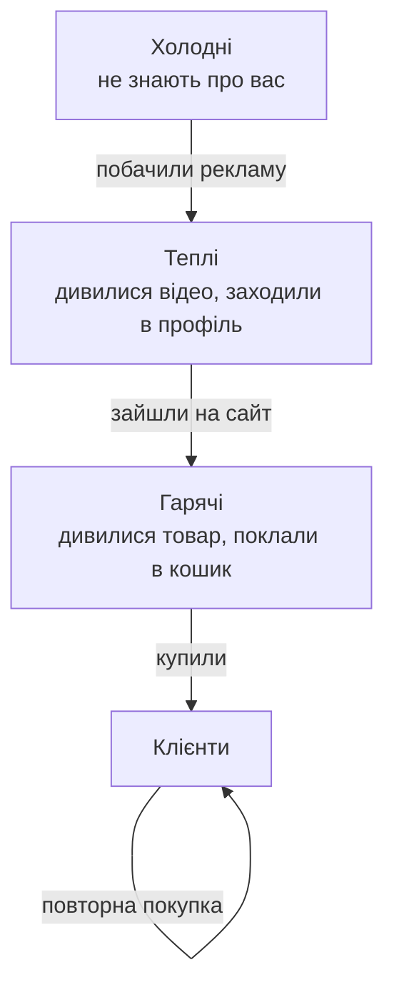

# Тепла аудиторія та воронка

Не всі люди однаково готові купити. Хтось бачить вас уперше, хтось уже тричі був на сайті. Воронка — простий спосіб про це думати.

## Що змінилося у 2026
Раніше для кожного етапу робили окрему кампанію. Зараз автопілот Advantage+ сам показує рекламу і новим, і теплим людям, тож **окремий ретаргетинг потрібен рідше**. (практика)

Але свої аудиторії однаково потрібні:

- **для виключень** — не показувати рекламу «приходьте вперше» тим, хто вже купив;
- **як підказка** роботу;
- **для окремого оферу** — коли теплим є що сказати особливого;
- **для звітів** — у сегментах аудиторії видно, скільки грошей іде своїм ([Неочевидні речі](08-hidden.md)).

## Які свої аудиторії можна зібрати
Розділ «Аудиторії» в Ads Manager → «Створити аудиторію» → «Індивідуально налаштована аудиторія».

| Джерело | Хто туди потрапляє | Скільки зберігається |
|---|---|---|
| Сайт (піксель) | Відвідувачі сайту, окремих сторінок, ті, хто поклав у кошик | до 180 днів; покупці — до 730 днів |
| Instagram-акаунт | Заходили в профіль, взаємодіяли, писали в Direct | до 365 днів |
| Сторінка Facebook | Взаємодіяли зі сторінкою | до 365 днів |
| Відео | Додивилися відео до 25%, 50%, 75%, 95% | до 365 днів |
| Миттєві форми | Відкрили або надіслали форму | до 90 днів |
| Список клієнтів | Завантажений файл з email і телефонами | доки не видалите |

Списки клієнтів завантажуйте лише з дотриманням GDPR: для такої обробки даних має бути законна підстава.

## Готові набори
Назви робіть зрозумілими, наприклад «САЙТ-кошик-14д» або «IG-взаємодія-90д».

- **Кошик без покупки, 7–14 днів** — найгарячіші.
- **Дивилися товар, 30 днів**.
- **Додивилися відео на 50%+, 90 днів** — теплі.
- **Взаємодіяли з Instagram, 180 днів**.
- **Покупці, 180 днів** — для виключення або для повторних продажів.

## Коли окрема кампанія для теплих має сенс
- Є **особливий офер**: «поверніться — безкоштовна доставка», «ви дивилися набір — ось відгуки про нього».
- **Довгий цикл рішення**: дорога послуга, захід. Потрібні нагадування, відповіді на заперечення, відгуки.
- **Повторні продажі**: витратні матеріали, сезонні товари. Покупцям через 2–3 місяці — «час оновити».

Тепла аудиторія маленька. Бюджет на неї — невеликий, частота швидко зростає. Стежте, щоб реклама не перетворилася на нав'язливе переслідування: при частоті понад 3–4 на тиждень люди починають дратуватися. (практика)

## Що показувати на кожному етапі
| Етап | Що потрібно людині | Приклад для Ані |
|---|---|---|
| Холодні | Зачепити, показати цінність | «Ця свічка горить 60 годин» |
| Теплі | Довіра, деталі | Процес виготовлення, відгуки |
| Гарячі | Зняти останні сумніви | Доставка, повернення, «лишилося 5 наборів» (якщо правда) |
| Клієнти | Привід повернутися | Нові аромати, набір до свята |

## Джерела
- [Meta for Developers: аудиторії відвідувачів сайту](https://developers.facebook.com/documentation/ads-commerce/marketing-api/audiences/guides/website-custom-audiences)
- [Common Thread: термін зберігання аудиторії покупців — 730 днів](https://commonthreadco.com/blogs/coachs-corner/meta-purchase-audience-730-days-ecommerce)
- [Benly: види індивідуальних аудиторій і терміни зберігання](https://benly.ai/learn/meta-ads/custom-audiences-guide)
- [Shopify: ретаргетинг та індивідуальні аудиторії](https://shopify.co.nz/guides/facebook-advertising/retargeting-and-custom-audiences)

Перевірено: листопад 2026.

--8<-- "abbr-uk.md"
